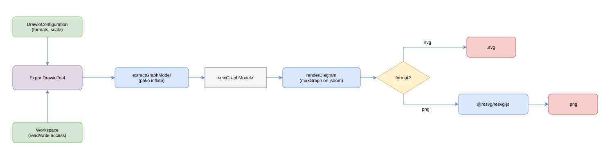

# LLM Chat Drawio

[](https://opensource.org/licenses/MIT)
[](https://www.npmjs.com/package/@johannes.latzel/llm-chat-drawio)
[](https://github.com/johanneslatzel/llm-chat-drawio/releases)
[](https://www.typescriptlang.org/)
[](https://github.com/johanneslatzel/llm-chat-drawio/pulls)
[](https://github.com/johanneslatzel/llm-chat-drawio/discussions)
[](https://codecov.io/gh/johanneslatzel/llm-chat-drawio)
[](https://github.com/johanneslatzel/llm-chat-drawio/actions/workflows/ci.yml)
[](https://badge.socket.dev/npm/package/@johannes.latzel/llm-chat-drawio/latest)
[](https://github.com/mefengl/made-by-ai)

Headless rendering tools for the `llm-chat` ecosystem: turn a `.drawio` file into an SVG or PNG image without a browser, X server, or the draw.io desktop app.

> **Disclaimer**: This package was written entirely by AI. Use at your own risk.



Rendering is done in-process with [maxGraph](https://github.com/maxGraph/maxGraph) (the maintained successor of mxGraph, draw.io's rendering core) running on a `jsdom` DOM, plus [@resvg/resvg-js](https://github.com/yisibl/resvg-js) for rasterisation. No subprocess, no headless browser.

## Features

- `export_drawio` tool: reads a `.drawio`/`.xml` file and writes an image
- [workspace](https://github.com/johanneslatzel/llm-chat-workspace)-aware input and output paths (read/write access enforced)
- SVG and PNG output, format chosen per call from a configured allowlist
- parses both compressed and uncompressed `.drawio` files
- `DrawioToolPackage` bundling the tool into a `ToolPackage`

## Prerequisites

- Node.js >= 22

## Installation

```bash
npm install @johannes.latzel/llm-chat-drawio
```

## Documentation

Full documentation at **[johanneslatzel.github.io/llm-chat-drawio/](https://johanneslatzel.github.io/llm-chat-drawio/)**

## License

MIT. See [`LICENSE`](LICENSE).

## Contributing

Issues and PRs welcome at [github.com/johanneslatzel/llm-chat-drawio](https://github.com/johanneslatzel/llm-chat-drawio).
